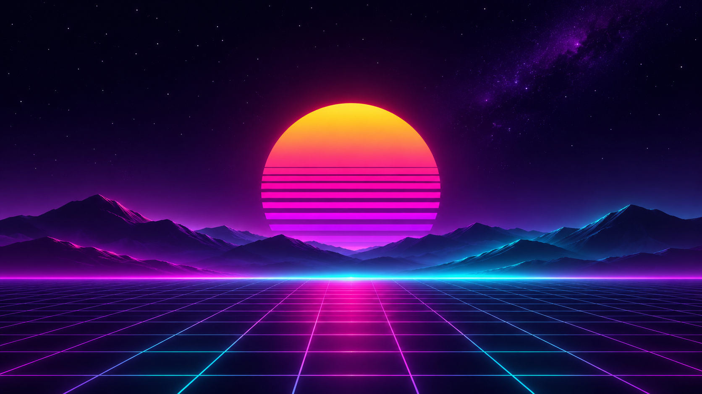

# nebulix

Tema escuro com neon roxo para GNOME/Ubuntu, *nebulosa + \*nix*. Personalizável ao vivo, com dock e ícones estilo macOS, e fácil de desfazer.
Testado no Ubuntu 26.04 LTS (GNOME 50, Wayland). Alvo: 26.10 (GNOME 51).


**Inclui:** apps GTK 3/4 e libadwaita, GNOME Shell (barra flutuante, menus), dock estilo macOS, ícones WhiteSur + pastas Nebulix, Ptyxis/GNOME Terminal, Starship, fastfetch, btop, VS Code, Neovim, wallpapers.

| | | | |
|---|---|---|---|
|  |  |  |  |

## Instalar

```bash
sudo apt install ./nebulix_0.2.0-3_all.deb    # ou o .tar.xz: ./install.sh
nebulix apply --dry-run                      # mostra o que mudaria, sem alterar nada
nebulix apply                                # aplica ao seu usuário
nebulix                                      # abre o app de personalização
```
Recomendado: `sudo apt install gnome-shell-extensions papirus-icon-theme` (tema do Shell e fallback de ícones) e `nebulix icons install` (baixa o WhiteSur, ~7 MB, com verificação sha256). `nebulix doctor` diz o que falta e como instalar.

## Personalizar

No app **Nebulix** ou pela CLI (aplica ao salvar):

```bash
nebulix config set accent=magenta variant=darker radius=10
nebulix config set window_buttons=mac topbar=solid dock_position=left
nebulix config set wallpaper=gen-orbit        # versões geradas seguem a cor de destaque
```
Chaves: `accent` (nebulix, magenta, cyan, blue, green, amber ou `#RRGGBB`), `variant` (dark, darker), `radius` (6 a 20), `window_buttons` (gnome, mac), `topbar` (floating, solid), `dock` (macos, ubuntu), `dock_position` (bottom, left, right), `dock_icon_size`, `dock_opacity`, `icons` (whitesur, papirus, keep), `wallpaper`, `components`. O arquivo fica em `~/.config/nebulix/config.toml`.

## Voltar ao padrão

| Comando | O que faz |
|---|---|
| `nebulix undo` | volta ao que estava antes do Nebulix (usa o backup em `~/.local/share/nebulix`) |
| `nebulix reset` | padrão de fábrica do Ubuntu (`gsettings reset` nas chaves tocadas, arquivos removidos/restaurados) |

Os dois também estão na aba **Restaurar** do app. Depois, `sudo apt remove nebulix` remove o pacote.

## Limitações
- libadwaita só aceita troca de cores; apps Qt/KDE e snaps podem ignorar o tema GTK.
- O Ubuntu Dock não tem ampliação nem desfoque como o macOS (o `doctor` sugere a extensão Blur my Shell).
- O CSS do Shell passa no parser do St, mas ainda não foi conferido visualmente num Shell real; abra uma issue com screenshot se algo ficar estranho.
- O tema do VS Code é copiado para `~/.vscode/extensions`; reinicie o editor.

## Desenvolver
`python3 -m unittest discover -s tests` (tudo em HOME descartável), `python3 build.py` (contraste WCAG para cada destaque e variante), `./package.sh` (gera `release/`). Veja `CONTRIBUTING.md`.

Licenças: código GPL-3.0-or-later (`LICENSE`), arte CC BY-SA 4.0 (`LICENSE-ART`), tema VS Code e Neovim MIT.
