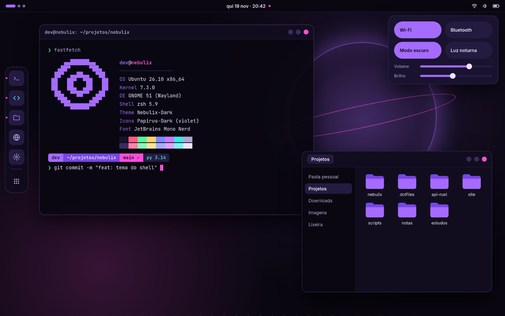
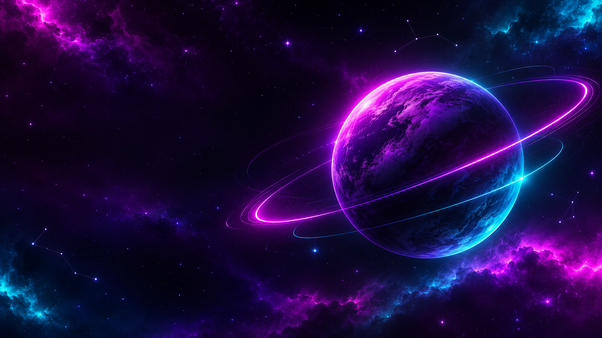
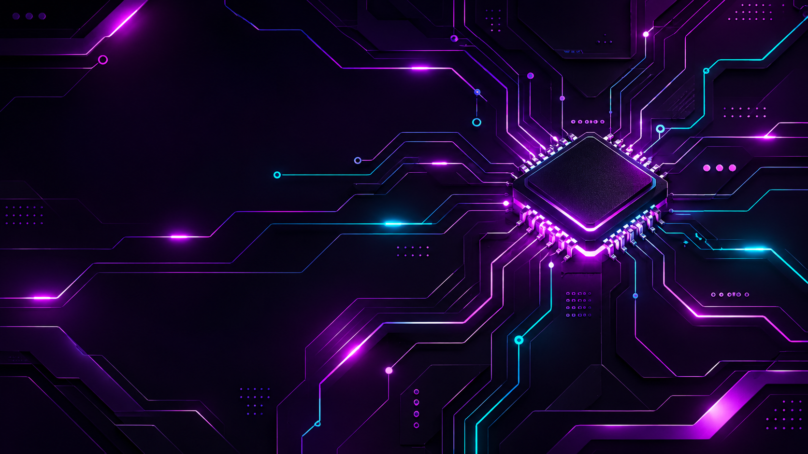
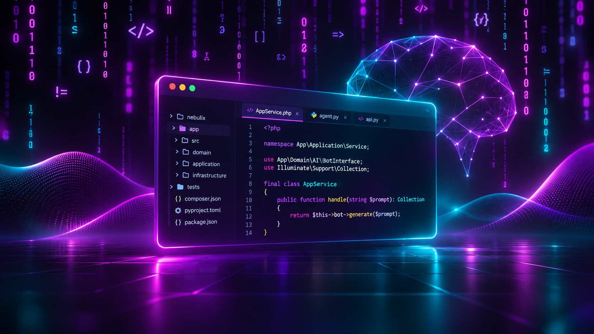

# nebulix

Temas para GNOME/Ubuntu, *nebulosa + \*nix*: **Nebulix** (roxo escuro), **macOS Dark**, **macOS Light** e **Nebulix Light**. Personalizável ao vivo, com dock e ícones estilo macOS, e fácil de desfazer.
Testado no Ubuntu 26.04 LTS (GNOME 50, Wayland). Alvo: 26.10 (GNOME 51).



**Inclui:** apps GTK 3/4 e libadwaita, GNOME Shell (barra flutuante, menus), dock estilo macOS, ícones WhiteSur + pastas Nebulix, Ptyxis/GNOME Terminal, Starship, fastfetch, btop, VS Code, Neovim, wallpapers.

| | | | |
|---|---|---|---|
|  |  |  |  |

## Instalar

```bash
sudo apt install ./nebulix_0.3.0-5_all.deb    # ou o .tar.xz: ./install.sh
nebulix apply --dry-run                      # mostra o que mudaria, sem alterar nada
nebulix apply                                # aplica ao seu usuário
nebulix                                      # abre o app de personalização
```
Recomendado: `sudo apt install gnome-shell-extensions papirus-icon-theme` (tema do Shell e fallback de ícones) e `nebulix icons install` (baixa o WhiteSur, ~7 MB, com verificação sha256). `nebulix doctor` diz o que falta e como instalar.

## Temas

| Tema | Visual | Pacote aplicado ao escolher |
|---|---|---|
| `nebulix` | roxo escuro neon (padrão) | destaque roxo, botões GNOME, barra flutuante, cantos 14 px, ícones WhiteSur roxos + pastas Nebulix, dock macOS |
| `macos-dark` | cinzas neutros `#161616`…`#3A3A3C`, azul `#0A84FF` | semáforo à esquerda, barra translúcida, cantos 10 px, ícones WhiteSur azuis, Inter |
| `macos-light` | cinzas claros `#F5F5F7`/`#FFFFFF`, azul `#007AFF` | igual ao macOS Dark, com ícones WhiteSur para fundo claro |
| `nebulix-light` | brancos lilás, roxo `#6B3DD9` | como o Nebulix, em claro |

```bash
nebulix theme                 # lista os temas
nebulix theme macos-dark      # aplica o tema e o pacote (alias: macos, claro = macos-light)
```
Escolher um tema define destaque (`accent = "auto"`, o padrão do tema), botões da janela, barra, cantos, ícones, dock e fonte; depois cada item continua ajustável. Os temas claros usam `color-scheme = prefer-light`, o stylesheet claro do GTK e do Shell, e o terminal, VS Code (`uiTheme: vs`), Neovim (`background=light`), Starship e btop acompanham a paleta. Os wallpapers existentes são usados como estão; os "gerados" usam sempre a versão escura da paleta. Sem desfoque real na barra e na dock (o Shell não tem filtro de fundo sem extensão).

## Personalizar

No app **Nebulix** ou pela CLI (aplica ao salvar):

```bash
nebulix config set accent=magenta variant=darker radius=10      # accent do tema ativo
nebulix config set window_buttons=mac topbar=solid dock_position=left
nebulix config set wallpaper=gen-orbit        # versões geradas seguem a cor de destaque
```
Chaves: `theme` (nebulix, macos-dark, macos-light, nebulix-light), `accent` (`auto`, um nome do tema ou `#RRGGBB`; Nebulix: nebulix, magenta, cyan, blue, green, amber; macOS: blue, purple, pink, red, orange, yellow, green, graphite), `variant` (dark, darker; só nos temas escuros), `radius` (6 a 20), `window_buttons` (gnome, mac), `topbar` (floating, solid, translucent), `font` (auto, keep), `vscode_theme` (keep, follow ou o id de um tema), `dock` (macos, ubuntu), `dock_position` (bottom, left, right), `dock_icon_size`, `dock_opacity`, `dock_zoom` (off, on), `dock_zoom_factor` (120 a 200, em %), `icons` (whitesur, papirus, keep), `wallpaper`, `components`. O arquivo fica em `~/.config/nebulix/config.toml`.

## Voltar ao padrão

| Comando | O que faz |
|---|---|
| `nebulix undo` | volta ao que estava antes do Nebulix (usa o backup em `~/.local/share/nebulix`) |
| `nebulix reset` | padrão de fábrica do Ubuntu (`gsettings reset` nas chaves tocadas, arquivos removidos/restaurados) |

Os dois também estão na aba **Restaurar** do app. Depois, `sudo apt remove nebulix` remove o pacote.

## Limitações
- libadwaita só aceita troca de cores; apps Qt/KDE e snaps podem ignorar o tema GTK.
- O Ubuntu Dock não tem desfoque como o macOS (o `doctor` sugere a extensão Blur my Shell). O zoom ao passar o mouse é opcional (`dock_zoom=on`): extensão `nebulix-dock-zoom` do Nebulix, que exige o Ubuntu Dock e, na primeira ativação, sair e entrar na sessão. A parte ampliada do ícone que passa da borda da dock não recebe cliques.
- O CSS do Shell passa no parser do St, mas ainda não foi conferido visualmente num Shell real; abra uma issue com screenshot se algo ficar estranho.
- O VS Code recebe uma extensão com os 4 temas em `~/.vscode/extensions` (também Insiders e VSCodium, se existirem). Com `vscode_theme = follow` (ou um tema específico) o Nebulix define `workbench.colorTheme` no `settings.json`, editando só essa chave (comentários e o resto ficam intactos); `undo` restaura o valor anterior e `reset` remove a chave. O padrão `keep` não mexe no `settings.json`. Reinicie o editor.

## Desenvolver
`python3 -m unittest discover -s tests` (tudo em HOME descartável), `python3 build.py` (contraste WCAG para cada tema, destaque e variante), `./package.sh` (gera `release/`). Veja `CONTRIBUTING.md`.

Licenças: código GPL-3.0-or-later (`LICENSE`), arte CC BY-SA 4.0 (`LICENSE-ART`), tema VS Code e Neovim MIT.
